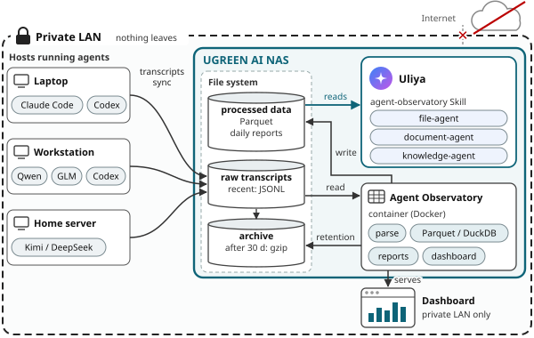
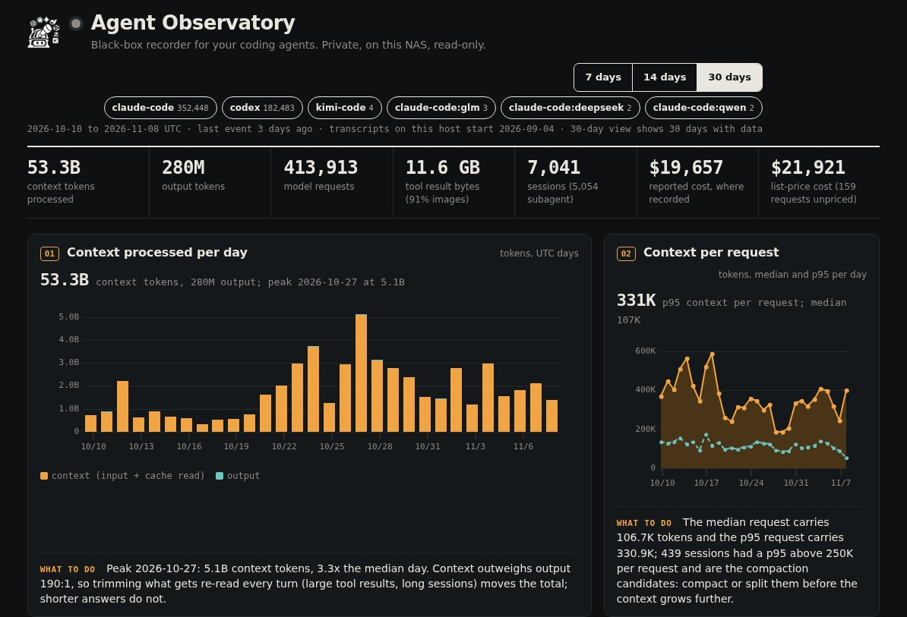

<p align="center"></p>

# Agent Observatory

Agent Observatory is a private black-box recorder for AI coding agents. A Docker container on your NAS reads the
session transcripts that Claude Code, Codex and Kimi Code already write to disk, turns them into Parquet, and every
few minutes rewrites daily Markdown/JSON reports that show where the tokens went: the largest tool outputs and how
often they were re-read, repeated payloads, retry loops, heavy sessions and models, and the cost at list prices. A
read-only dashboard serves the same numbers on your LAN, and the `agent-observatory` Skill lets UGREEN Uliya answer
"what burned my quota yesterday and how do I fix it" from those reports. Nothing leaves the network.





## Quick start

```sh
mkdir -p transcripts/claude transcripts/codex observatory
# copy or sync ~/.claude/projects/* into transcripts/claude and ~/.codex/sessions/* into transcripts/codex
docker compose up -d --build
```

Open `http://<nas-address>:8787`. The first cycle reads the last 30 days; later cycles re-read the last 3.

`compose.yaml` mounts two volumes:

| host | container | mode | content |
|---|---|---|---|
| `./transcripts` | `/transcripts` | read-only | `claude/<project>/<session>.jsonl` (plus `<session>/subagents/`) and `codex/<yyyy>/<mm>/<dd>/rollout-*.jsonl`. A folder with neither `claude/` nor `codex/` is read as Claude Code projects. |
| `./observatory` | `/data` | read-write | everything the container writes (below) |

It also raises the open-file limit (`ulimits: nofile: 65536`), because ingest and reports open every day file and
1024 is too low. The container runs as uid 1000; uncomment `user:` in `compose.yaml` if `./observatory` belongs to
another user.

Settings (environment): `OBS_INTERVAL` minutes between cycles (default 10), `OBS_BACKFILL` days on the first cycle
(30), `OBS_RECENT` days on later cycles (3), `OBS_HOST` name used in the Parquet file names, `OBS_RETAIN_DAYS`
(30; 0 disables) for the daily step that gzips transcripts older than that many days. That step needs a writable
transcripts mount; with the default read-only mount it logs an error and the recorder carries on, so set
`OBS_RETAIN_DAYS=0` to keep the log clean.

## What the container writes

Under `/data` (`./observatory` on the NAS):

- `events/<YYYY-MM-DD>/*.parquet`: one row per model request, tool call, tool result and subagent spawn, partitioned
  by UTC day.
- `sources.json`, `ingest_stats*.json`, `watch_status.json`: transcript roots, per-run counts, last cycle status.
- `reports/<YYYY-MM-DD>.md` and `reports/<YYYY-MM-DD>.json`: the daily report for each of the newest 3 days, rewritten
  every cycle; `reports/latest.md` and `reports/README.md`.
- `reports/<YYYY-MM-DD>/`: `report.html` (self-contained, opens offline), ledgers `tool-calls.csv`,
  `bash-commands.csv`, `model-requests.csv`, `subagents.csv`, `skills.csv`, and `excerpts/*.txt` (first 4 KB of
  each ranked item, scanned and redacted before write).

The report format is documented in [`skill/agent-observatory/references/report-format.md`](skill/agent-observatory/references/report-format.md).
`examples/2026-11-08.md` and `examples/2026-11-08.json` are a full daily report produced from generated transcripts
(no real data):

```sh
obs synth --out /tmp/tx --days 14 --start 2026-10-27
obs ingest all --root /tmp/tx --since 60d --out /tmp/obs-data
obs report --date 2026-11-08 --data /tmp/obs-data --out /tmp/obs-reports
```

## The Skill

[`skill/agent-observatory/`](skill/agent-observatory/) is a UGREEN Uliya Skill (`SKILL.md` plus
`references/report-format.md`). It reads only the reports, never transcripts, from a folder the user names
(for example `observatory/reports`). It delegates to three agents: `file-agent` (`ug-filesystem`), `document-agent`
(`ug-document`) and `knowledge-agent` (`ug-knowledge`).

1. Locate reports: `file-agent` lists the `YYYY-MM-DD.md` files and stats the requested day (and the comparison day).
2. Extract aggregates: `document-agent` returns the `aggregates` JSON block of each report verbatim.
3. Rank waste: repeated payloads, the largest single tool outputs, retry loops and image views, by re-read tokens.
4. Explain a spike: `document-agent` reconciles two days and names the tool, session and model behind the difference.
5. Evidence across days (optional): `knowledge-agent` finds other days with the same repeated payloads or loops.
6. Save a recommendations note: `knowledge-agent` writes it into the report folder after the user approves.

Every step uses only the real result of the step before; numbers are quoted, never invented.

## Supported harnesses

| harness | transcripts read | `harness` value |
|---|---|---|
| Claude Code | `~/.claude/projects` | `claude-code` |
| Claude Code profiles (another config home, for example DeepSeek, GLM or Qwen models through Claude Code) | `~/.claude-<name>/projects` | `claude-code:<name>` |
| Codex | `~/.codex/sessions` | `codex` |
| Kimi Code | `~/.kimi-code/sessions` | `kimi-code` |

The container ingests `claude/` and `codex/`. On a host with Python 3.9+, `pip install .` gives the `obs` command:
`obs ingest all --out data/` reads all of the default folders above, including every `~/.claude-*/projects`;
`obs ingest claude --root ~/.claude/projects --root deepseek=~/.claude-deepseek/projects` names profile roots
explicitly; `obs ingest kimi`, `obs report --date YYYY-MM-DD`, `obs summary --since 30d` and `obs serve` work on
the same `data/` folder.

## Privacy model

- LAN only. The dashboard has no login and is meant for a private network. It serves panel data computed from
  the Parquet events (counts, tokens, costs, tool names, shell commands, file paths), not prompts or tool output
  text; `/api/pointer` only says whether a transcript line is present on this host.
- Ingest-time masking. Shell commands are stored with secret-looking tokens (key prefixes such as `sk-` and `ghp_`,
  `Bearer`/`Basic` values, `token=`/`password=` style pairs and flags, credentials in URLs, long random strings)
  replaced by `***`.
- No outbound calls. Ingest, reports and the dashboard make no network requests; the chart library is vendored in
  `obs/static/`. The one command that fetches anything is the manual `obs prices fetch-openrouter`, which downloads
  OpenRouter list prices into `obs/prices-openrouter.yaml`.
- Write-time masking. `obs report` (and every container cycle) span-masks command text in the ledgers, the excerpts
  and `report.html` before writing them; `obs report --no-mask` turns this off. Detected spans: emails (the `@` and
  domain dots are kept), phone numbers, IPv4/IPv6 addresses (not loopback), API-key shapes (`sk-`, `gh?_`, `xox?-`,
  `AKIA`/`ASIA`; a short prefix is kept), JWTs, PEM blocks, Telegram bot tokens, high-entropy strings, exact values
  of known secrets read from env files in `~/.secrets` and `/run/secrets`, and names from `OBS_NAME_LIST`. Every
  masked character becomes `X`, so lengths and columns are unchanged. A row or excerpt that contains a keyword from
  `OBS_MASK_KEYWORDS` is masked in full. The built-in name and keyword lists (`Alice,Carol`;
  `Atlantis,Atlantean,El Dorado`) are examples; set both variables for your own deployment.
- Excerpts are scanned before write and findings are replaced with `[redacted:<kind>]`.
- `obs redact SRC DST` copies transcripts in allowlist mode: all prose and tool inputs become `X`, tool outputs keep
  their text except scanner findings, known secrets and names; ids, timestamps, models and usage are kept, one output
  line per input line, so report pointers stay valid. `obs redact-reports SRC DST` applies the same span masking to
  a reports tree. Both accept `--dry-run`.
- `obs scan PATH...` prints a findings table and exits 1 on any finding.

## Tests

```sh
pip install '.[test]'
pytest -q
```

## Licence

All rights reserved during the UGREEN AI NAS Hackathon 2026. An MIT licence is planned after judging.

The vendored uPlot chart library keeps its own licence (`obs/static/uPlot.LICENSE`).
