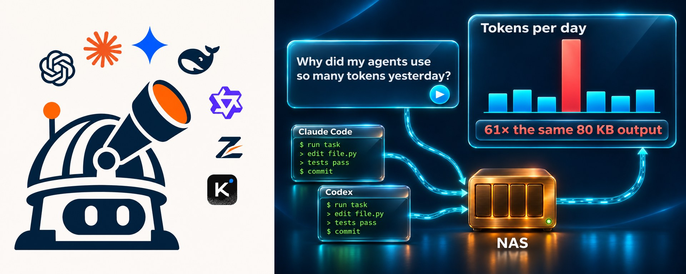
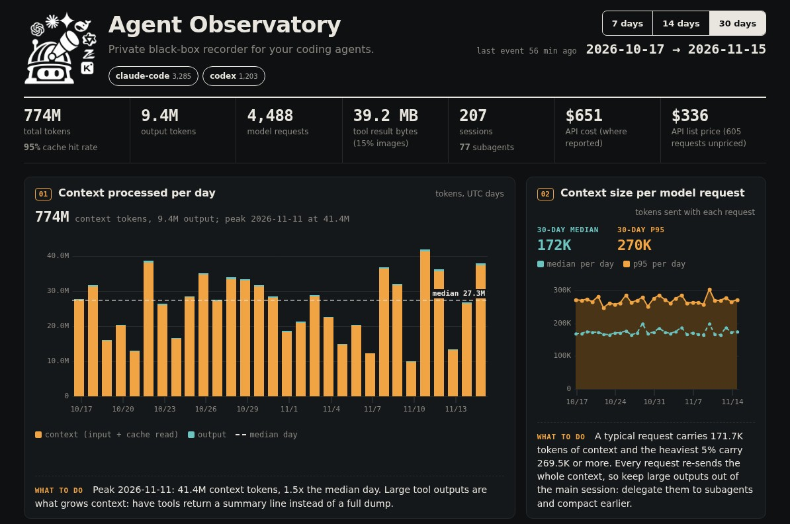
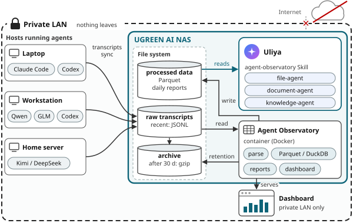
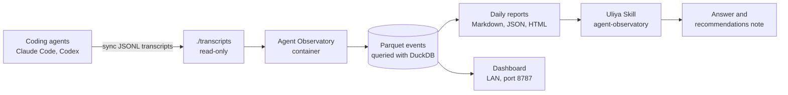
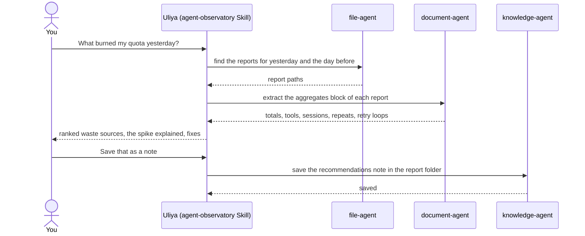

<p align="center"></p>

<h1 align="center">Agent Observatory</h1>

<p align="center"><b>A private black-box recorder for your AI coding agents.<br>
Find out what burned your quota, and how to stop it, without your transcripts leaving home.</b></p>

<p align="center">
  
  
  
  
  
  
  
  
</p>

---

You start the morning with a full quota. By lunch it is gone. The provider dashboard shows one number: total
tokens. It does not say *which* tool, *which* session or *which* habit of your agent used them.

The answer is already on your disk. Claude Code, Codex and the other coding agents write a transcript of every
session: each model request, each tool call, each tool output. Agent Observatory reads those transcripts on your
NAS, keeps them as compact Parquet files, and tells you in plain words where the tokens went and what to change.

You get three things:

- **A daily report** in Markdown and JSON (plus a self-contained HTML page) for every day.
- **A dashboard** on your home network with 14 panels and a 7, 14 or 30 day view.
- **An Uliya Skill**, so you can simply ask your UGREEN NAS: *"What burned my quota yesterday, and how do I fix it?"*

Nothing is sent to the internet. No account, no cloud, no telemetry.

## What you get

These findings come from the example report in [`examples/2026-11-08.md`](examples/2026-11-08.md), which the
project builds from generated (synthetic) transcripts. On your own data you will see the same kinds of findings.

- **The same 80 KB tool output, re-sent 61 times.** One `fetch_logs` call returned 80,000 bytes, and the agent
  called it again and again with the same result. Every later model request carries those outputs in its context
  until the next compaction, so the report counts about 59.6 million re-read tokens for this one payload.
- **A command that failed 14 times in a row.** The report lists retry loops: the same tool with the same input,
  failing again and again. Each one points at the exact transcript line where it starts.
- **Why one day used far more than the day before.** Input tokens rose 264% against the previous day. The report
  reconciles the two days and names the tool behind the jump (`fetch_logs`, 4.88 MB of new tool output).
- **What fills the context.** Reads are grouped by file kind (code, Markdown, logs, JSONL transcripts, images and
  more), each with a short "what to do" line, for example: search logs for the latest error instead of reading
  them whole.
- **Cost per harness and model** at list prices, next to the cost the harness itself recorded, where it did.

Every ranked item has a `file:line` pointer into the transcript and a short, redacted excerpt, so you can check
the finding yourself. `obs verify-pointers` re-opens a sample of pointers and checks each line and its hash.

## The dashboard



*30 days of synthetic data (`obs synth --days 30 --seed 7`).*

The header shows totals for the chosen range: tokens, cache hit rate, model requests, tool output bytes, sessions,
subagents and cost. Below it are 14 panels:

| Where the tokens go | What wastes them | How your agents work |
|---|---|---|
| Context processed per day | Largest single tool outputs | Subagents |
| Context size per model request | Repeated payloads | Skills invoked |
| Model mix | Retry loops | Compactions |
| Heaviest sessions | Top tools by result bytes | Before / after |
| | Read by file type | |
| | Shell | |

Each panel ends with a short **What to do** hint computed from its own numbers. **Before / after** compares the
7 days before and after a date you set with `OBS_MARKER="YYYY-MM-DD|label"` (for example the day you changed a
habit), so you can see whether a fix worked. You can filter by harness (for example only `codex`), and the view is
kept in the URL, so a link opens the same view again.

## How it works





1. **Collect.** You copy or sync the agents' transcript folders into `./transcripts` on the NAS. The container
   mounts this folder read-only.
2. **Record.** Every 10 minutes the container reads new transcript lines and writes one row per model request,
   tool call, tool result and subagent spawn into Parquet files, one folder per UTC day. The first cycle reads
   the last 30 days; later cycles re-read the last 3.
3. **Report.** After each cycle it rewrites the daily reports for the newest 3 days: `reports/<date>.md` and
   `.json`, plus a folder with `report.html`, per-call CSV ledgers and redacted excerpts.
4. **Show.** The same container serves the dashboard on port 8787.
5. **Ask.** The Uliya Skill reads the reports (never the transcripts) and answers your question.

## Quick start

You need Docker with Compose on the NAS, and a copy of this repository there.

### 1. Try it with synthetic data

```sh
git clone https://github.com/claudes-world/agent-observatory.git
cd agent-observatory
mkdir -p transcripts observatory
docker compose build
# write 30 days of generated transcripts into ./transcripts
docker run --rm -v "$PWD/transcripts:/transcripts" agent-observatory:latest \
  obs synth --out /transcripts --days 30
docker compose up -d
```

Open `http://<nas-address>:8787`. On synthetic data the first reports appear in `./observatory/reports` within
a minute.

The container runs as uid 1000. If `./observatory` belongs to another user on your NAS, set `user:` in
`compose.yaml` to that user's uid and gid.

### 2. Use your own transcripts

Stop the container, empty `./transcripts`, and put your agents' folders there in this layout:

| folder in `./transcripts` | copy or sync from |
|---|---|
| `claude/` | `~/.claude/projects/*` (Claude Code) |
| `codex/` | `~/.codex/sessions/*` (Codex) |

A folder with neither `claude/` nor `codex/` is read as Claude Code projects. Then `docker compose up -d` again.
Keep the folders in sync (for example with a scheduled `rsync`) and the reports follow.

Settings go in the `environment:` block of `compose.yaml`:

| variable | default | meaning |
|---|---|---|
| `OBS_INTERVAL` | `10` | minutes between cycles |
| `OBS_BACKFILL` | `30` | days read on the first cycle |
| `OBS_RECENT` | `3` | days re-read on later cycles |
| `OBS_HOST` | `nas` | name used in the Parquet file names |
| `OBS_MARKER` | built-in date | `YYYY-MM-DD\|label` for the Before / after panel |
| `OBS_RETAIN_DAYS` | `30` | daily step that gzips transcripts older than this; needs a writable `./transcripts`. With the default read-only mount it logs an error and carries on, so set `0` to turn it off |

### 3. Without Docker

On any computer with Python 3.9 or newer:

```sh
pip install .
obs synth --out tx --days 30                 # or skip this and use your own transcripts
obs ingest all --root tx --since 30d --out data/   # without --root: the default folders of every supported agent
obs report --date YYYY-MM-DD --data data/ --out reports/  # any day of the last 30
obs serve --data data/                       # dashboard on http://127.0.0.1:8787
```

Other commands: `obs summary --since 30d`, `obs watch` (what the container runs), `obs scan`, `obs redact`,
`obs redact-reports`, `obs verify-pointers`, `obs retire` and `obs prices fetch-openrouter`. Run `obs <command> -h`
for the options.

## Ask Uliya

[`skill/agent-observatory/`](skill/agent-observatory/) is a Skill for **Uliya**, the assistant on UGREEN AI NAS.
It works only with the reports, from a folder you name (for example `observatory/reports`). It never opens a
transcript.



What you can ask:

- *"What burned my quota yesterday?"* Uliya ranks the waste: repeated payloads, the largest single tool outputs,
  retry loops and image views, by re-read tokens, and names the tool and the numbers for each.
- *"Why did usage jump on the 8th compared to the 7th?"* Uliya reconciles the two reports and names the tool,
  session and model behind the difference.
- *"Has this happened before?"* Uliya looks for other days with the same repeated payloads or loops.
- *"Save the fixes."* After you agree, Uliya writes a recommendations note into the report folder.

The fixes follow from the data. For a command that dumps the same large output many times, the advice is: wrap the
command so it prints one summary line (pass or fail, with counts), and read the full output only when it fails.
Uliya quotes the numbers from the reports and does not invent any. If there is no report for the day, it says so
and lists the nearest days that exist.

The report format the Skill relies on is documented in
[`references/report-format.md`](skill/agent-observatory/references/report-format.md).

## Privacy

Your transcripts hold your code, your prompts and sometimes your secrets. Agent Observatory is built so that they
stay on your network.

- **No outbound calls.** Ingest, reports and the dashboard make no network requests. The chart library is
  included in the repository (`obs/static/`). The only command that downloads anything is the manual
  `obs prices fetch-openrouter`, which fetches list prices.
- **LAN only.** The dashboard has no login; keep it on your private network. It serves numbers, tool names, shell
  commands and file paths, not prompts and not tool output text.
- **Read-only transcripts.** The container mounts `./transcripts` read-only by default.
- **Masking when recording.** Secret-looking values in shell commands (key prefixes such as `sk-` and `ghp_`,
  `Bearer` values, `password=` pairs, credentials in URLs, long random strings) are stored as `***`.
- **Masking when writing reports.** Ledgers, excerpts and `report.html` are span-masked: emails, phone numbers,
  IP addresses, API keys, JWTs, PEM blocks, bot tokens, high-entropy strings, exact values of known secrets from
  env files in `~/.secrets` and `/run/secrets`, and names from `OBS_NAME_LIST`. Masked characters become `X`, so
  lengths and columns stay the same. A row that contains a keyword from `OBS_MASK_KEYWORDS` is masked in full.
  The built-in name and keyword lists are only examples; set both variables for your own setup.
- **Redacted excerpts.** Each excerpt is scanned before it is written; findings become `[redacted:<kind>]`.
- **Tools to share safely.** `obs redact SRC DST` copies transcripts with all prose and tool inputs masked, while
  ids, timestamps, models and token counts stay, so report pointers still work. `obs redact-reports` does the same
  for a reports folder, and `obs scan PATH...` prints any findings and exits with code 1 if there are some.

## Supported agents

| agent | transcripts | read by the container | read by `obs ingest` |
|---|---|:---:|:---:|
| Claude Code | `~/.claude/projects` | yes | yes |
| Claude Code profiles, for example Qwen, GLM or DeepSeek models through Claude Code | `~/.claude-<name>/projects` | copied into `claude/`, counted as Claude Code | yes, as `claude-code:<name>` |
| Codex | `~/.codex/sessions` | yes | yes |
| Kimi Code | `~/.kimi-code/sessions` | | yes (`obs ingest kimi`) |
| Antigravity (`agy`, Gemini models) | `~/.gemini/antigravity-cli/brain/` | | yes (`obs ingest agy`) |

The container reads the `claude/` and `codex/` folders. Kimi Code and Antigravity are read with `obs ingest` on a
computer with Python, into the same data folder. The model column shows the model each request used.

## Project layout

```text
agent-observatory/
├── compose.yaml          # the NAS service: volumes, port 8787, settings
├── Dockerfile            # python:3.12-slim, runs `obs watch`
├── pyproject.toml        # the `obs` command; duckdb, pyarrow, fastapi, uvicorn
├── obs/                  # the recorder
│   ├── ingest.py         #   transcripts to Parquet (Claude Code, Codex, Kimi Code, Antigravity)
│   ├── report.py         #   daily Markdown, JSON, HTML reports and CSV ledgers
│   ├── panels.py         #   the dashboard panels and their "what to do" lines
│   ├── dashboard.py      #   the LAN dashboard (FastAPI)
│   ├── watch.py          #   the container loop: ingest, report, serve
│   ├── scan.py, redact.py, redact_reports.py, excerpts.py   # privacy
│   ├── synth.py          #   synthetic transcripts
│   └── static/           #   dashboard page and the bundled chart library
├── skill/agent-observatory/   # the Uliya Skill and the report format
├── examples/             # a full daily report made from synthetic transcripts
├── docs/                 # banner, architecture diagram, dashboard picture
├── tests/                # pytest suite
└── bin/test              # runs the tests, prints one PASS/FAIL line
```

## Tests

```sh
pip install '.[test]'
bin/test        # PASS 105 passed, 1 skipped
```

`bin/test` prints one line and keeps the full log in `build/test.log`; on a failure it also prints the failing
tests. Plain `pytest -q` works too.

## Status and licence

Agent Observatory is an entry in the **UGREEN AI NAS Hackathon 2026**. Version 0.2.0.

All rights reserved during the UGREEN AI NAS Hackathon 2026. An MIT licence is planned after judging
(see [`NOTICE`](NOTICE)).

The bundled uPlot chart library keeps its own licence ([`obs/static/uPlot.LICENSE`](obs/static/uPlot.LICENSE)).
